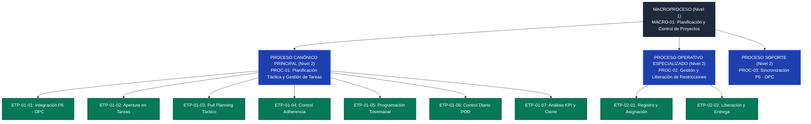

# INFORME TÉCNICO DE MODELADO Y DESCOMPOSICIÓN DE PROCESOS BPMN 2.0 (AS-IS)
> **Especialista / Autor:** Sebastián Roca G.  
> **Contacto:** +56993543447 | **Correo Institucional:** sjroca@salfamontajes.com  
> **Organización:** SALFA Montajes S.A. — Excelencia Operacional y Planificación  
> **Código de Diagrama:** `10000000-SAL-00000-DOC-DIA-00001` | **Procedimiento Rector:** `10000000-PRO-EST-001 (Rev. 0)`

**Caso de Aplicación:** Planificación Táctica y Gestión de Restricciones (Metodología Lean Construction en OPC)  
**Documento Fuente:** `10000000-PRO-EST-001` Rev. 0 y anexos operativos  
**Organización:** SALFA Montajes S.A.  
**Estándares de Referencia:** BPMN 2.0 (ISO/IEC 19510), ABPMP BPM CBOK v4.0, WfMC BPSim 2.0  
**Estado:** Modelo AS-IS fielmente levantado desde documentación formal.

---

## 1. ARQUITECTURA JERÁRQUICA EMPRESARIAL (NIVELES 1 A 4)

Conforme a las mejores prácticas de arquitectura empresarial y la taxonomía de descomposición de procesos, la documentación analizada se estructura en 4 niveles de granularidad:

---

## 2. FICHA TÉCNICA DE LOS PROCESOS IDENTIFICADOS

| Atributo | Proceso Canónico 1 (`PROC-01`) | Proceso Relacionado (`PROC-02`) |
| :--- | :--- | :--- |
| **Nombre Canónico** | **Planificación Táctica y Gestión de Tareas Last Planner** | **Gestión y Liberación de Restricciones** |
| **Nivel Jerárquico** | Nivel 2 (Proceso Operativo Central) | Nivel 2 (Proceso Operativo Especializado) |
| **Disparador (Trigger)** | Evento de Tiempo: Corte semanal del proyecto (Viernes) | Evento Condicional / Mensaje: Detección de interferencia en faena |
| **Resultado Verificable (Fin)** | Ciclo semanal cerrado: tareas ejecutadas, causas de no cumplimiento analizadas y KPI en Power BI | Restricción físicamente liberada y formalmente entregada en OPC |
| **Objeto de Negocio Principal** | **Tarea de Producción (Task)** | **Restricción de Terreno (Constraint)** |
| **Cadena de Estados del Objeto** | `Identificada` $\rightarrow$ `Programada` $\rightarrow$ `Asignada` $\rightarrow$ `Comprometida` $\rightarrow$ `[Recomprometida]` $\rightarrow$ `Finalizada` | `No Planificada` $\rightarrow$ `Planificada (Fecha Prometida)` $\rightarrow$ `Entregada / Liberada` |
| **Frecuencia del Ciclo** | Semanal con ciclo interno diario (POD) | Continua a demanda (por evento) |
| **Sistemas Involucrados** | Oracle Primavera Cloud (OPC), Primavera P6 EPPM, Power BI | Oracle Primavera Cloud (Módulo Restricciones), App Móvil OPC Lean |

---

## 3. RELACIÓN OPERATIVA Y MECANISMOS DE ACOPLAMIENTO

`PROC-01` y `PROC-02` operan de forma coordinada mediante tres mecanismos clave:

1. **Invocación mediante Subproceso Reutilizable (`Call Activity`):**
   Durante las etapas `ETP-01-03` (Pull Planning) y `ETP-01-04` (Actividades no programadas), cuando se constata que una tarea tiene una interferencia de materiales, ingeniería o permisos, `PROC-01` invoca formalmente a `PROC-02`. La tarea queda en estado *Bloqueada por Restricción*.
2. **Hand-Off de Datos y Desbloqueo (`Intermediate Link / Hand-off`):**
   `PROC-02` avanza de manera independiente por su carril de gestión (asignación de parte responsable y gestión de liberación). Cuando la restricción alcanza el estado **`Entregada`**, emite un evento de finalización que alimenta directamente a la etapa `ETP-01-05` de `PROC-01`.
3. **Regla de Negocio Bloqueante:**
   Ninguna tarea puede pasar a estado `Comprometida` ni ingresar al programa trisemanal de la semana en curso si mantiene restricciones abiertas. Esto garantiza que a terreno solo ingresen trabajos 100% ejecutables.

---

## 4. MATRIZ DETALLADA DE SUBPROCESOS Y ETAPAS

### Subprocesos de `PROC-01`: Planificación Táctica
* **`ETP-01-01` Integración P6 EPPM – OPC:** Sincronización automática de hitos y fechas entre el cronograma contractual y la plataforma de gestión operativa de tareas.
* **`ETP-01-02` Apertura de Actividades en Tareas:** Desglose fino realizado por los Jefes de Área y Supervisores en paquetes menores a 3 días con instrucción técnica precisa y balance de horas hombre ($PF \le 1$).
* **`ETP-01-03` Identificación de Restricciones (Pull Planning):** Sesiones colaborativas a 3 meses (estratégico) y 3 semanas (táctico) donde se proyectan las necesidades y se derivan las restricciones a `PROC-02`.
* **`ETP-01-04` Control de Adherencia y Actividades no Programadas:** Identificación de actividades del cronograma que no cuentan con tareas asociadas y asignación obligatoria de la restricción justificativa.
* **`ETP-01-05` Programación Trisemanal y Compromiso:** Selección exclusiva de tareas libres de restricciones, asignación de supervisores y formalización del compromiso de entrega.
* **`ETP-01-06` Ejecución y Control Diario (POD):** Revisión diaria en faena al cierre de turno, reporte de avance físico, captura de horas ganadas y activación de tareas colchón ante fallas.
* **`ETP-01-07` Análisis de Cumplimiento Semanal y KPI:** Cálculo de PPC (Porcentaje de Plan Cumplido), categorización de Causas de No Cumplimiento (CNC) según catálogo corporativo y transferencia de avance a Primavera P6.

### Subprocesos de `PROC-02`: Gestión de Restricciones
* **`ETP-02-01` Registro, Vinculación y Asignación:** Captura del hallazgo, tipificación según catálogo de familias corporativas, asignación de la parte responsable por el Administrador de Obra y vinculación a las tareas afectadas.
* **`ETP-02-02` Gestión de Liberación y Entrega:** Negociación y compromiso de la fecha prometida, ejecución de acciones de mitigación en bodega, compras o ingeniería, entrega formal en OPC y validación por supervisión de terreno.
