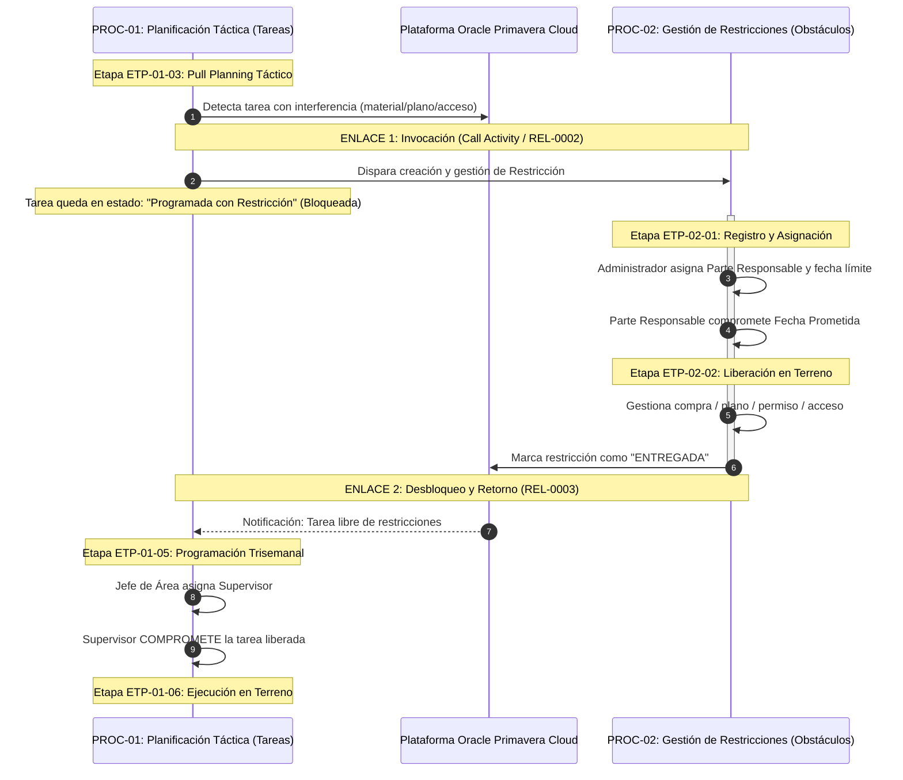

# MATRIZ DE INTERACCIÓN OPERATIVA Y HAND-OFFS ENTRE PROCESOS

> **Especialista / Autor:** Sebastián Roca G.  
> **Contacto:** +56993543447 | **Correo Institucional:** sjroca@salfamontajes.com  
> **Organización:** SALFA Montajes S.A. — Excelencia Operacional y Planificación  
> **Código de Diagrama:** `10000000-SAL-00000-DOC-DIA-00001` | **Procedimiento Rector:** `10000000-PRO-EST-001 (Rev. 0)`

> **Arquitectura de Integración de Procesos:** Describe cómo interactúan y se transfieren el flujo los dos procesos canónicos principales pertenecientes al Macroproceso de Planificación y Control (`PROC-01: Planificación Táctica` y `PROC-02: Gestión de Restricciones`), garantizando sincronización y confiabilidad en terreno.

---

## 1. CUADRO COMPARATIVO DE PROCESOS RELACIONADOS

| Parámetro de Diseño | `PROC-01`: Planificación Táctica y Tareas | `PROC-02`: Gestión de Restricciones |
| :--- | :--- | :--- |
| **Rol en el Negocio** | Gestión del Flujo de Producción y Compromisos | Remoción Sistemática de Obstáculos de Faena |
| **Disparador (Trigger)** | Periódico / Timer: Corte semanal del proyecto | Continuo / Evento: Detección de interferencia |
| **Objeto de Gestión** | **Tarea Operativa (Task)** | **Restricción (Constraint)** |
| **Líder Operativo** | Jefe de Área (Último Planificador / Last Planner) | Administrador de Obra / Parte Responsable |
| **Tiempo de Ciclo** | Ciclo semanal cerrado (Lunes a Viernes) | Variable (según criticidad y fecha requerida) |
| **Métrica Clave** | Porcentaje de Plan Cumplido (PPC) | Tasa de Restricciones Liberadas a Tiempo |

---

## 2. PUNTOS DE ACOPLAMIENTO (HAND-OFFS Y LLAMADAS)

---

## 3. TABLA DE PROTOCOLOS DE COMUNICACIÓN ENTRE PROCESOS

| ID Enlace | Evento Origen | Proceso Emisor | Proceso Receptor | Objeto Transferido | Impacto en el Proceso Receptor |
| :--- | :--- | :--- | :--- | :--- | :--- |
| **`REL-0001`** | Finalización de sincronización programada | `PROC-03` (Sincronización P6-OPC) | `PROC-01` (Planificación Táctica) | Cronograma Maestro Actualizado | Habilita la apertura de tareas en `ETP-01-02` con fechas contractuales vigentes. |
| **`REL-0002`** | Tarea con interferencia identificada en Pull Planning | `PROC-01` (`ETP-01-03` / `ETP-01-04`) | `PROC-02` (Gestión de Restricciones) | Ficha de Restricción (Tag, CWA, CWP/IWP, Tipo) | Dispara la búsqueda de solución y asignación formal de parte responsable. |
| **`REL-0003`** | Restricción cambia a estado `Entregada` | `PROC-02` (`ETP-02-02`) | `PROC-01` (`ETP-01-05`) | Confirmación de Liberación de Tarea | Permite que la tarea pase a la mesa trisemanal y sea formalmente comprometida. |
| **`REL-0005`** | Cierre de jornada semanal (Viernes) | `PROC-01` (`ETP-01-07`) | `PROC-01` (Nuevo ciclo semanal) | Avance físico real y causas de desvío (CNC) | Alimenta la reprogramación de P6 en el corte de los viernes y da inicio al ciclo semanal siguiente. |
