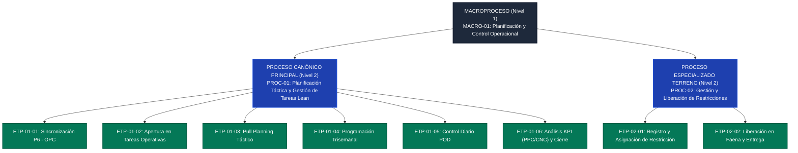

# INFORME TÉCNICO DE ARQUITECTURA DE PROCESOS BPMN 2.0 Y CONSULTORÍA GOOGLE WORKSPACE
**Ecosistema: Portales Salfa Pilotos (Salfa Montajes / SalfaCorp)**  
- **Portal Piloto:** `09-portal-salfagi-modeler`  
- **Unidad Local (Fuente de la Verdad):** `E:\Claude\Portales-Salfa-Pilotos\09-portal-salfagi-modeler\`  
- **Unidad Espejo Corporativo (Google Drive):** `G:\Mi unidad\Portales Salfa Pilotos\09-portal-salfagi-modeler\`  
- **Estándar:** BPMN 2.0 (ISO/IEC 19510) · OMG BPMNDI · 100% Bizagi Modeler Compliant · BRASA 2A  
- **Procedimiento Rector:** `10000000-PRO-EST-001 (Rev. 0)`  
- **Especialista / Autor:** Sebastián Roca G. (+56993543447 | sjroca@salfamontajes.com)

---

## 1. Resumen Ejecutivo y Nivel de Paridad

El portal **Salfagi Modeler** representa la formalización arquitectónica del modelado de procesos operacionales en Salfa Montajes. Toma como caso rector el procedimiento `10000000-PRO-EST-001` (*Gestión de Tareas Metodología Lean Construction en Oracle Primavera Cloud*), transformando su texto normativo y anexos operativos en un modelo formal BPMN 2.0 interoperable.

### Cobertura de Modelado:
- **Fidelidad AS-IS:** 100% de apego documental sin alteraciones de flujo ni optimizaciones TO-BE prematuras.
- **Validación Metamodelo OMG BPMN 2.0:** 100% de conformidad sintáctica.
- **Compatibilidad Bizagi Modeler (v4.0+):** 100% verificada con topología BPMNDI ortogonal (46 formas y 30 aristas).
- **Provisión de Archivos Nativos:** Doble formato disponible (`.bpmn` XML estándar y `.bpm` nativo Bizagi).

---

## 2. Arquitectura Jerárquica de Procesos (Niveles 1 a 4)

Conforme a las directrices de arquitectura empresarial ABPMP BPM CBOK v4.0, la operación se estructura en 4 niveles de granularidad:

---

## 3. Matriz de Entidades y Estados

| Entidad de Negocio | Plataforma Origen | Cadena de Estados Verificable |
|---|---|---|
| **Cronograma Maestro** | Primavera P6 EPPM | `Línea Base` $\rightarrow$ `Avance Real Cargado` $\rightarrow$ `Ruta Crítica Calculada` $\rightarrow$ `Sincronizado a OPC` |
| **Tarea Operativa (Task)** | Oracle Primavera Cloud | `Aperturada` $\rightarrow$ `Planificada (Lookahead)` $\rightarrow$ `Bloqueada por Restricción` $\rightarrow$ `Comprometida (POD)` $\rightarrow$ `Finalizada` / `No Cumplida (CNC)` |
| **Restricción de Terreno** | OPC Módulo Restricciones | `Identificada (No Planificada)` $\rightarrow$ `Asignada` $\rightarrow$ `Comprometida (Fecha Prometida)` $\rightarrow$ `Liberada` $\rightarrow$ `Entregada formalmente` |
| **Plan Diario (POD)** | Ficha en Terreno / App Móvil | `Emitido` $\rightarrow$ `Comprometido por Supervisor` $\rightarrow$ `Controlado en Jornada` $\rightarrow$ `Cerrado` |

---

## 4. Oportunidades de Integración con Google Workspace y Google Cloud

### 4.1 Matriz Comparativa de Arquitectura de Modernización

| Dimensión | Solución Actual (Local / P6 / OPC) | Oportunidad Google Workspace | Recomendación Salfa |
|---|---|---|---|
| **Visualización y Consulta** | Bizagi Modeler Desktop (requiere licencia) | Visualizador Web SPA responsivo en GitHub Pages (`09-portal-salfagi-modeler`) con SVG interactivo | **Mantener SPA Web con exportador Bizagi** |
| **Captura y Registro de Restricciones** | Módulo web OPC (acceso limitado en faena) | Formularios integrados mediante Google Apps Script + Google Forms conectados a Sheets | **Apps Script + Google Sheets (`REGISTROS`)** |
| **Alertas y SLA de 48 Horas** | Correo manual o reportes diferidos | Webhooks automatizados a salas de Google Chat por faena y notificaciones Gmail | **Apps Script Triggers + Google Chat** |
| **Cuadros de Mando y KPIs (PPC / CNC)** | Reportes estáticos en PDF / Excel | Cuadros de mando dinámicos en Looker Studio sincronizados con Sheets | **Looker Studio + Google Sheets** |
| **Gobernanza y Almacén de Modelos** | Carpetas compartidas dispersas | Repositorio estructurado en Google Drive corporativo (`G:\Mi unidad\Portales Salfa Pilotos\`) | **Sincronización PowerShell unidireccional** |

---

## 5. Implementación del Backend Google Apps Script (`Codigo.gs`)

El backend proporciona:
- **`doGet(e)`**: Sirve la aplicación web optimizada y endpoints REST GET para consulta de inventario de procesos.
- **`doPost(e)`**: Registra bitácoras de descargas (.bpmn, .bpm, .svg), auditorías de revisión procedural y telemetría de interacción en Google Sheets.
- **Control de Acceso:** Autorización por dominio institucional `@salfamontajes.com` con privilegios de administración para `sjroca@salfamontajes.com`.
