# APLICACIÓN MÓVIL ANDROID · PORTALES SALFA HUB (SUPER-APP)
**Ecosistema: Portales Salfa Pilotos · Salfa Montajes / SalfaCorp**  
*Punto de Acceso Central y Contenedor Integrado para todos los Portales Pilotos*

---

## 1. Visión General y Arquitectura Super-App
Esta aplicación Android (`com.salfamontajes.hub`) es el **Hub Móvil Central** de Salfa Montajes. Ha sido diseñada con una arquitectura de **Contenedor Dual (Hub + Portales Hijos)** para resolver la navegación unificada en faena y oficina:

```mermaid
graph TD
  A["📱 App Android: Portales Salfa (com.salfamontajes.hub)"] --> B["Capa Hub (hubWebView)"]
  A --> C["Capa Portales Hijos (portalWebView)"]
  A --> D["Barra Superior Nativa In-App (portalTopBar)"]

  B --> B1["Catálogo de 8+ Portales Pilotos"]
  B --> B2["Filtros por Categoría y Búsqueda"]
  B --> B3["Single Sign-On Corporativo"]

  D --> D1["← Botón 'Volver al Hub' (Retorno instantáneo)"]
  D --> D2["Píldora del Portal Activo ([06] Salfa Flow)"]
  D --> D3["🔀 Botón 'Cambiar Portal' (BottomSheet Switcher)"]
  D --> D4["🔄 Recargar Portal"]

  C --> C1["01 · Mapa de Procesos BPMN"]
  C --> C2["02 · Control de CV y Competencias"]
  C --> C3["03 · Salfa Work Management"]
  C --> C6["06 · Salfa Flow (Tareas & Terreno)"]
  C --> C7["07 · Autodesk Construction Cloud (ACC)"]
  C --> C8["08 · Agente AWP (Metodología CII)"]
  C --> C5["05 · Gestión de Información"]
  C --> C4["04 · Indicadores OKR"]
```



### Características Principales:
1. **Acceso a Todos los Portales en una Sola App:** No requiere instalar una app separada por cada piloto; el Hub agrupa todo el portafolio tecnológico.
2. **Navegación In-App sin Salir de la Aplicación:** Al pulsar cualquier portal, este se abre dentro del contenedor integrado con aceleración por hardware.
3. **Cambio Rápido entre Portales (`🔀 Cambiar Portal`):** Mediante un BottomSheet táctil nativo, el usuario puede saltar de un portal a otro (ej. de *Salfa Flow* a *Autodesk ACC* o al *Agente AWP*) sin perder su sesión ni tener que volver a iniciar sesión.
4. **Retorno Inmediato (`← Volver al Hub`):** El Hub principal permanece cargado en memoria de fondo, permitiendo volver a la pantalla de inicio sin ningún retraso.
5. **Gestión Inteligente del Botón Atrás:**
   - Si se presiona Atrás dentro de un portal con subpáginas, navega hacia atrás internamente.
   - Si se presiona Atrás en la raíz del portal, **regresa suavemente al Hub**.
   - Solo al estar en el Hub principal solicita confirmación para salir.

---

## 2. Estructura de Archivos del Proyecto Android

```text
00-portal-hub/android/
├── settings.gradle                         # Configuración de módulos Gradle (:app)
├── build.gradle                            # Gradle raíz
├── gradle.properties                       # Parámetros JVM y soporte AndroidX
├── compilar-android.ps1                    # Script PowerShell de validación y compilación
├── compilar-android.bat                    # Acceso rápido en Windows
├── README.md                               # Documentación técnica
└── app/
    ├── build.gradle                        # SDK 34, ViewBinding, Material 3, WebKit
    └── src/main/
        ├── AndroidManifest.xml             # Permisos (Cámara, Red, Vibración) y FileProvider
        ├── java/com/salfamontajes/hub/
        │   ├── MainActivity.kt             # Orquestador del Hub, contenedor hijo y navegación in-app
        │   ├── PortalManager.kt            # Registro de portales con resolución local/remota
        │   ├── PortalModel.kt              # Modelo de datos de portal
        │   └── SalfaHubBridge.kt           # Puente bidireccional JavaScript - Android
        └── res/
            ├── layout/
            │   ├── activity_main.xml       # Layout con Hub, Portal Container y Topbar
            │   ├── bottom_sheet_portales.xml # Selector de cambio de portales
            │   └── item_portal_card.xml    # Tarjeta táctil de portal en selector
            ├── values/
            │   ├── strings.xml             # Textos corporativos
            │   ├── colors.xml              # Paleta oficial Salfa Montajes
            │   └── themes.xml              # Tema sin barra superior y BottomSheet
            └── drawable/
                ├── ic_salfa_hub_logo.xml   # Logotipo Salfa Montajes en vector
                └── splash_background.xml   # Splash screen corporativo
```

---

## 3. Instrucciones de Compilación y Generación del APK

### Opción A: Compilación y Ejecución en Android Studio (Recomendada)
1. Abrir **Android Studio**.
2. Seleccionar **File -> Open...** y navegar hasta la carpeta:
   `E:\Claude\Portales-Salfa-Pilotos\00-portal-hub\android\`
3. Esperar que Gradle sincronice las dependencias (*Gradle Sync*).
4. Para ejecutar en emulador o en tu celular conectado por USB:
   - Presionar **Run 'app'** (`Shift + F10`).
5. Para generar el APK instalable:
   - Ir a **Build -> Build Bundle(s) / APK(s) -> Build APK(s)**.
   - El archivo se generará en:
     `00-portal-hub/android/app/build/outputs/apk/debug/app-debug.apk`

### Opción B: Compilación Rápida por Consola
En una consola PowerShell:
```powershell
powershell -ExecutionPolicy Bypass -File "E:\Claude\Portales-Salfa-Pilotos\00-portal-hub\android\compilar-android.ps1"
```
O haciendo doble clic sobre `compilar-android.bat`.

---

## 4. Instalación del APK en el Teléfono Celular
1. Conectar el celular Android por cable USB con depuración USB habilitada.
2. Ejecutar por terminal:
   ```bash
   adb install "00-portal-hub/android/app/build/outputs/apk/debug/app-debug.apk"
   ```
3. O copiar el archivo `.apk` a Google Drive / memoria interna del teléfono y abrirlo para instalarlo.
